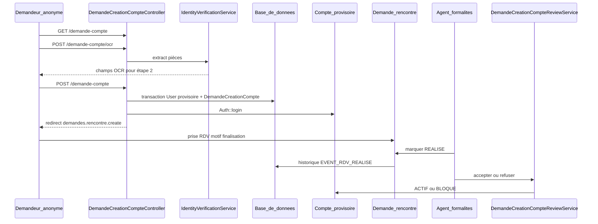

# Fonctionnement de la demande de création de compte

## Vue d’ensemble

Le parcours remplace l’inscription directe classique pour les **pensionnés** (avec cas **mineur** + représentant). Il sépare trois notions :

| Élément | Rôle |
|---------|------|
| `app/Models/DemandeCreationCompte.php` | Dossier métier (`en_attente` → `acceptee` / `refusee`), pièces jointes (Spatie Media), historique |
| `app/Models/User.php` avec `account_status = provisoire` | Compte créé **dès la soumission**, accès limité jusqu’à validation |
| `app/Models/Demande.php` type `DEMANDE_RENCONTRE` | Rendez-vous **demande_formalites_mandats** (Service Formalités), prérequis à la décision agent |

---

## 1. Entrée publique (sans connexion)

**Routes** (`routes/web.php`) :

- `GET /demande-compte` → formulaire `resources/views/auth/demande-compte.blade.php`
- `POST /demande-compte/ocr` → pré-remplissage via OCR
- `GET /demande-compte/disponibilite` → NIF, code pension, e-mail déjà pris
- `POST /demande-compte` → soumission finale

**Contrôleur** : `app/Http/Controllers/DemandeCreationCompteController.php`.

### Étape OCR (optionnelle mais prévue par le wizard)

- Pièces : CIN / passeport / permis, ou **matricule fiscal** ; si **mineur** : acte de naissance + pièce du représentant (`pere` / `mere` / `tuteur`).
- `app/Services/AccountCreation/IdentityVerificationService.php` appelle le service OCR configuré et extrait nom, prénom, etc. pour l’étape suivante.

### Soumission (`store`)

1. **Validation** (`validateDemande`) : identité, téléphone/adresse, mot de passe, NIF/NINU (code pension **optionnel**), acceptation des conditions.
2. **Anti-doublons** (3 niveaux) :
   - clé `idempotency_key` (double clic / refresh) ;
   - recherche d’une demande « vivante » sur les mêmes identifiants (`findExistingDemande`) ;
   - récupération en cas de course sur contrainte unique DB.
3. **Transaction unique** :
   - `createProvisionalUser()` : `User` avec `account_status = provisoire`, username `prenom.nom`, mot de passe **choisi sur le formulaire** (pas généré côté serveur) ;
   - `app/Services/Account/ProvisionalAccountProfileService.php` : rôles/catégories provisoires ;
   - création `DemandeCreationCompte` (`status = en_attente`, code unique, `user_id` lié) ;
   - pièces dans collections Media (`DemandeCreationCompte::MEDIA_LABELS`) ;
   - historique `SOUMISE` + `COMPTE_PROVISOIRE_CREE` ;
   - `app/Services/Pension/BeneficiaireProvisioningService.php` : amorce bénéficiaire / affiliation pension selon adulte vs mineur.
4. **Notification** `DemandeCreationCompteSoumise` si e-mail réel (pas `@provisoire.dpc.ht`).
5. **`redirectToRdv`** : connexion automatique du user provisoire puis redirection vers **`demandes.rencontre.create`** (prise de RDV).

---

## 2. Vie du compte provisoire

**Middleware** `app/Http/Middleware/EnsurePermanentAccount.php` bloque les démarches métier et renvoie vers `resources/views/compte/provisoire.blade.php` si le statut n’est pas `actif`.

**Autorisé en provisoire** (extrait) : tableau de bord personal, notifications, compléments sur demandes, **RDV pensionné**, consultation `/mon-compte/demande-creation` via `MonDemandeCreationCompteController` (show/update tant que `en_attente`).

---

## 3. Rendez-vous de finalisation (obligatoire avant décision)

- Motif clé : `DemandeCreationCompte::MOTIF_RDV_FINALISATION` = `demande_formalites_mandats` (`config/rencontre.php`). L’ancien motif `finalisation_creation_compte` reste reconnu pour les dossiers déjà déposés.
- Service responsable : **Formalités** ; documents à apporter définis dans la config (pièce d’identité, matricule fiscal, etc.).

**Condition métier** sur le modèle (`DemandeCreationCompte::canBeDecided()`) : la demande doit être `en_attente` **et** un RDV de finalisation doit être marqué **réalisé** (`hasRendezVousRealise()`).

Quand un agent marque le RDV **`REALISE`**, `app/Services/RencontreWorkflowService.php` enregistre `EVENT_RDV_REALISE` sur l’historique du dossier compte (si le demandeur est encore provisoire et la demande `en_attente`).

---

## 4. Revue côté administration / formalités

**UI double** — même contrôleur, préfixe de routes différent :

- Agents **formalités** : `formalites/comptes-demandes/*` — **peuvent accepter/refuser** (`canDecide` = rôle agent formalités, pas sur routes `admin.*`).
- **Admin** : liste/consultation sans décision (`canDecide = false`).

`DemandeCreationCompteManagementController` délègue à `app/Services/AccountCreation/DemandeCreationCompteReviewService.php`.

### Acceptation

- Vérifie : toujours `en_attente` + RDV réalisé.
- Met à jour le **même** user provisoire : `account_status = ACTIF`, e-mail/nom éventuellement corrigés par l’agent.
- Demande → `acceptee`, `approuvee_at`, historique `ACCEPTEE` + `COMPTE_ACTIVE`.
- Re-provisionne bénéficiaire (`provisionAdultSelf` ou `provisionFromDemandeCreation` si mineur).
- Notification `DemandeCreationCompteAccepteeNotification` (pas de nouveau mot de passe généré : l’usager garde celui du formulaire).

### Refus

- User → `BLOQUE` ; demande → `refusee` + `refusal_reason`.
- Historique `REFUSEE` + `COMPTE_BLOQUE`.
- Notification mail/SMS via `DemandeCreationCompteRefuseeNotification`.

---

## 5. Données et traçabilité

- **Statuts demande** : `en_attente`, `acceptee`, `refusee`.
- **Historique** : `DemandeCreationCompteHistory` + journal Spatie Activity (`compte_creation`).
- **Unicité en attente** : NIF, NINU, code pension, téléphone — `pendingDigitsMatch` / `pendingTelephoneExists` pour éviter deux dossiers ouverts identiques.
- **Purge** : `purgeIdentityDocuments()` / `purgePersonalData()` pour effacement des pièces et champs sensibles après traitement (selon flux métier).

---

## 6. Tests de référence

- `tests/Feature/DemandeCreationCompteTest.php` — soumission, user provisoire, historique.
- `tests/Feature/DemandeCreationCompteManagementTest.php` — blocage sans RDV réalisé, accept/refuse après RDV.

---

## Résumé

Le demandeur remplit le formulaire public (OCR + pièces) → obtient immédiatement un **compte provisoire** et une **demande en attente** → doit **passer un RDV formalités** marqué réalisé → un **agent formalités** **active** le compte ou le **bloque** avec motif ; seuls les comptes **actifs** accèdent aux démarches pension complètes.
